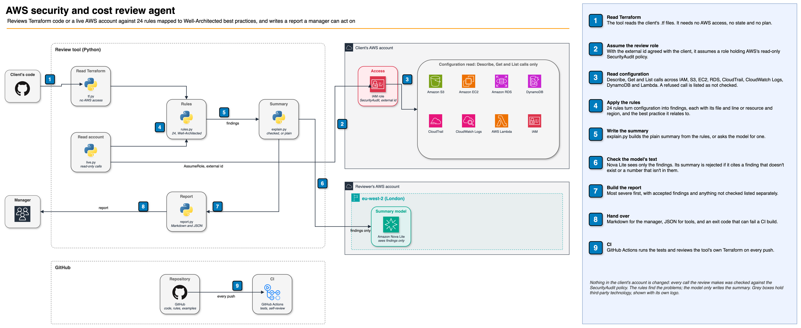

# AWS security and cost review agent

[](https://github.com/tapiwa-magumise/aws-security-cost-review/actions/workflows/ci.yml)

Points at a company's AWS setup, its Terraform code or the live account, and writes a report a manager can act on: where it's exposed, where it pays for nothing, and what would fail badly. Each finding says where it is, why it matters, the fix, and the AWS Well-Architected best practice behind it. The rules find the problems; a model only writes the summary, and its text is checked against the findings before it's used.



Editable source: [`docs/architecture.drawio`](docs/architecture.drawio). Portrait version for social posts: [`docs/linkedin-architecture.drawio`](docs/linkedin-architecture.drawio).

**Start with the results:** [docs/03-results.md](docs/03-results.md), from running it on this portfolio's own code and AWS account.

| | |
|---|---|
| [01-brief.md](docs/01-brief.md) | The client, and the requirements it's judged on |
| [02-decisions.md](docs/02-decisions.md) | Every choice, the alternative, and what it gives up |
| [03-results.md](docs/03-results.md) | What it found in this portfolio's eight projects and its AWS account |
| [04-build-log.md](docs/04-build-log.md) | What went wrong or surprised me, and what I did |
| [examples/](examples) | Two full reports: a sample built to break every rule, and the live account |

## What it checks

24 rules, each mapped to a Well-Architected best practice:

| Pillar | Examples |
|---|---|
| Security | Databases or disks not encrypted, a database or SSH open to the internet, administrator-level IAM policies, passwords written into code, no CloudTrail, root user without MFA, old access keys |
| Cost | Logs kept forever, unattached disks, unused public IP addresses, gp2 volumes that cost more than gp3 |
| Reliability | Database backups switched off, no point-in-time recovery on DynamoDB, single-AZ databases, unversioned buckets |

A finding the owner has accepted on purpose is reported with its reason instead of as a problem: `# review: accept RULE_ID reason` inside the resource.

## Status

Built, tested and run. The summary is meant to be written by Amazon Nova Lite in London, but Bedrock is refusing model calls on this AWS account, and I'm currently working on it with AWS. Until it's restored, every report uses the plain summary built from the rules and says so. That fallback is the path a client gets whenever the model is unavailable, and it's tested.

## Running it

```bash
python3.13 -m venv .venv && .venv/bin/pip install -r requirements.txt

# Terraform: no AWS access needed
PYTHONPATH=src .venv/bin/python -m review terraform path/to/repo --out out

# A live account, read-only, with your own credentials or the client's review role
PYTHONPATH=src .venv/bin/python -m review account --regions eu-west-2,eu-west-1 \
  --role-arn arn:aws:iam::<client-account>:role/security-cost-review --external-id <agreed value> --out out

# Add --explain for the model-written summary, and --fail-on high to fail a CI build
.venv/bin/pytest -q
```

The client creates the review role with [`terraform/`](terraform): AWS's read-only SecurityAudit policy, which only the reviewer can assume, and only with the external id they agree. Every API call the review makes was checked against that policy.

## How it stays honest

- A rule only reports what the configuration shows. Values that Terraform can only know at plan time are left alone, and the report says so.
- A check the account refuses is listed as not checked, never as passed.
- The model sees the findings and nothing else. Its summary is rejected if it cites a finding that doesn't exist or uses a number that isn't in the findings.
- Every Terraform rule is tested both catching its problem and passing correct configuration, and the live checks are tested against a mocked AWS account. The two gaps are listed in the results.
